# Annual mandatory training with certificates

This guide covers one setup: a small organisation where everyone studies the material on their own, takes an exam, and gets a certificate that is valid for one year. Each person renews when their own certificate is about to expire. The certificates are your audit evidence. There is no AI, no gamification and no spaced repetition (Leitner).

It describes Learning 5.14.0. A few things are not in the app yet. They are marked **(coming)**. Unfamiliar terms are explained in the [glossary](#glossary) at the end. The screenshots come from a test instance with made-up people and an invented organisation, "Northwind Safety Ltd"; `scripts/screenshots/run.sh` in the repository takes them again.

You need two kinds of account:
- a **Nextcloud administrator** for step 1;
- an **instructor** for steps 2–10. An instructor is a Nextcloud administrator or someone named under "Instructors (groups and people)" (see step 1).

**Contents**

1. [Prepare the server](#step-1--prepare-the-server-administrator-once)
2. [Create the course](#step-2--create-the-course)
3. [Provide the learning material](#step-3--provide-the-learning-material)
4. [Create the question pools and add them to the course](#step-4--create-the-question-pools-and-add-them-to-the-course)
5. [Set up certification and the exam](#step-5--set-up-certification-and-the-exam)
6. [Switch off what you don't need](#step-6--switch-off-what-you-dont-need)
7. [Enrol your people](#step-7--enrol-your-people)
8. [What learners see (and how to test it)](#step-8--what-learners-see-and-how-to-test-it)
9. [The yearly renewal](#step-9--the-yearly-renewal)
10. [Audit evidence](#step-10--audit-evidence)

---

## Step 1 — Prepare the server (administrator, once)

Open **Administration settings → Learning**.

1. **Signing key for certificates.** Until this key exists, nobody gets a certificate, even after passing. At the top of the page, click **Generate signing key**. You can also run this on the server command line:
   ```
   occ learning:cert:init-issuer
   ```
   When it worked, the page says "Signing key generated. Certificates are now active."
2. **Gamification enabled:** switch it **off**, and do it **before you create the course**. A course created while gamification is off starts with Duel, Gameshow, League and Adventure switched off. Courses that already exist are not changed. With gamification off, learners see no XP, levels, streaks or badges, and the whole competition area (leaderboard, League, Arena, Adventure) is hidden for everyone, instructors included.
3. **AI provider:** choose **Disabled**. This hides the AI chat (the "ExplainBot" tab), the "Knowledge" tab, the "Extract" buttons and "Generate questions". In the personal settings the voice and character options and the AI consent section are left out too; a consent someone gave earlier can still be revoked there.
4. **Daily Challenge enabled:** switch it off if you don't want it.
5. **Instructors (groups and people):** if the person who runs the training is not a Nextcloud administrator, add that person, or a group they belong to. You can pick several groups and individual people. They can then create courses and question pools. Nextcloud administrators always count as instructors. If nothing is selected, the group `learning-instructors` applies. Leave **Allow course-based instructor fallback** switched off (the page recommends this).
6. **Exam attempts per 24h (per user, pool and course)** (default 5) and **Exam cooldown (minutes)** (default 10): change these if you want a stricter or looser retake rule. Learners see these numbers.
7. **Operator details (imprint and privacy notice):** fill in name, postal address and contact email, then click **Save operator details**.
8. Click **Save**.
9. Optional: **Certificate logos.** If the certificate should show a different logo than Nextcloud's own (for example your full logo, while Nextcloud only shows a small icon), enter a name under **Add a logo**, click **Upload logo …** and pick a PNG, JPEG or WebP file (at most 1 MB and 3000 × 3000 pixels; SVG is not accepted, because the logo also appears on the public verification page). Each logo shows how many courses use it. Instructors choose it per course (step 5).

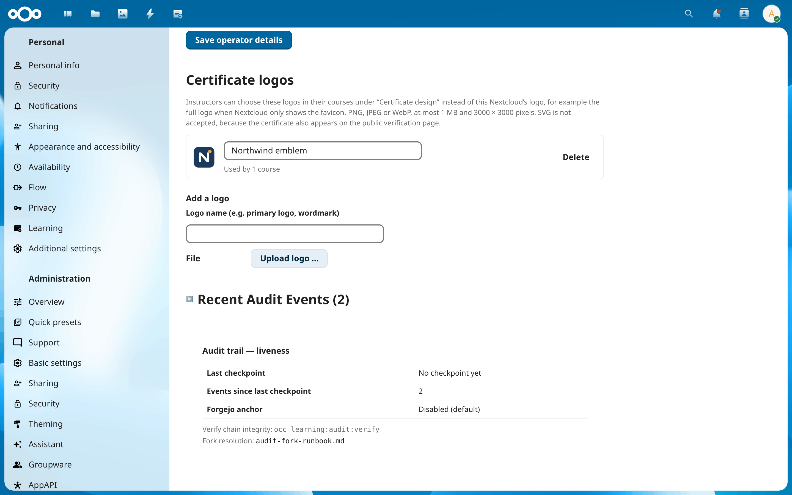

Outside the Learning page:

- **Organisation name and logo on the certificate.** The certificate shows an organisation name and a logo at the top, on screen, when printed and on the verification page. The name is, in this order: the course's **Organisation name on the certificate** (Certificate design), the legal name from the operator details (Administration → Learning), the name from Nextcloud's **Theming** settings. A switch **Show organisation name** hides the name next to the logo, for a logo that already spells it out; the signed certificate and the verification page keep the name. The logo is Theming's, unless the course picks one from the **certificate logos** an administrator uploaded under Administration → Learning (PNG, JPEG or WebP, no SVG). The name is written into the signed certificate when it is issued, and the logo is copied with the certificate (the library logo, or Theming's logo as it is at that moment), so later changes in the course, in the library or in Theming do not change existing certificates. Two exceptions show the current Theming logo instead: certificates issued before 5.14.0, and certificates issued while the Theming logo is an SVG without a PNG version (Learning keeps only PNG, JPEG and WebP; upload the Theming logo as PNG, or put a PNG of it into the library). The signed certificate file itself (Open Badges, for wallets) names the Theming logo by its web address, so a wallet shows the current Theming logo. Set name and logo before the first real certificate is issued.
- **Background jobs (Cron) must run.** Expiry reminders, the renewal window and the closing of expired periods all run as Nextcloud background jobs. Check under **Administration settings → Basic settings** that background jobs use Cron and ran recently.
- **E-mail.** Learning does not send e-mail itself. It sends Nextcloud notifications (the bell icon): "You were enrolled in the course …", "Certificate issued: …", and the expiry reminders. These reach people by e-mail only if Nextcloud is set up to send notification e-mails: an e-mail server under Basic settings, an e-mail address on each account, and e-mail reminders switched on in the Notifications settings.
- **How long evidence is kept.** By default, certificate and audit data are anonymised **3 years after the certificate's issue date**. After that, the certificate can no longer be verified. If your regulation asks for a longer period, change it before you go live, for example:
  ```
  occ config:app:set learning retention_years --value=<years your regulation requires>
  ```
  The value `0` turns automatic anonymisation off.

---

## Step 2 — Create the course

1. In Learning, open **Courses** and click **+ Create Course**.
2. Enter a **Title**, for example "Annual safety training", and optionally a **Description**.
3. Under **Course profile**, choose **Mandatory training with certificate**. This switches off Leitner, the simulator tools, the Class register, Learning partner, the game modes and "Add to LinkedIn", and switches on the certification. It is only a preset: you can change each switch later (steps 5 and 6).
4. Leave **Nextcloud group** empty for now. You will enrol people in step 7.
5. Click **Create**.

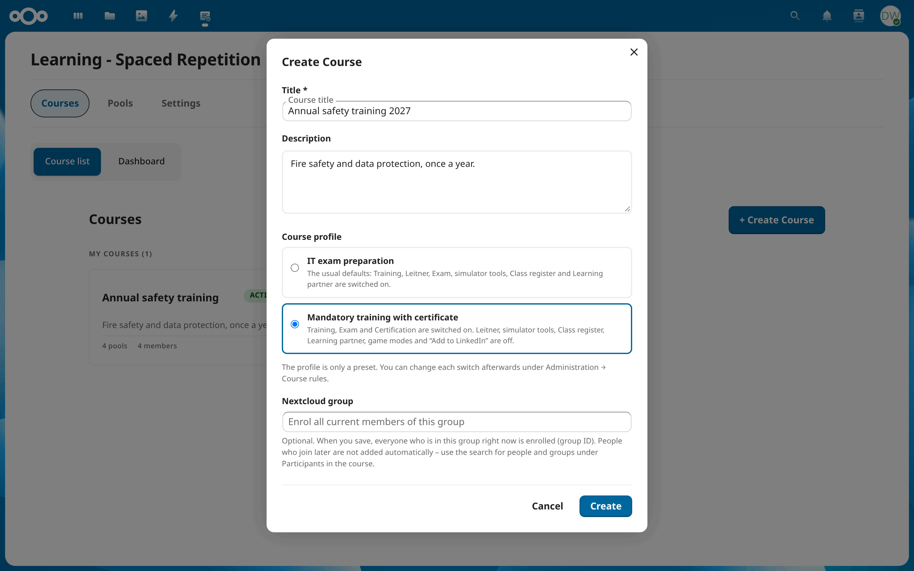

Open the course. As an instructor, you see the areas **Learning space**, **Participants**, **Communication** and **Administration** (with gamification off there is no **Competition** area).

---

## Step 3 — Provide the learning material

The material lives in a normal Nextcloud folder in **your own** files (you are the course owner). Learners do not need a share. The app shows them the files.

1. In your Nextcloud Files, create a folder, for example `/Training 2027`, and upload your PDF or Markdown files.
2. In the course, go to **Learning space → Learning materials**.
3. Under **Material folder**, click **Choose folder…**, pick the folder and click **Link this folder**. (Or type the path and click **Link folder**.) The folder is linked and scanned straight away.
4. Whenever you add or replace files later, click **Scan folder**. Otherwise learners won't see the new files.

The page says: "Course members can open every PDF and Markdown file in this folder." Learners click a file name to open it in the browser.

**Required documents.** The file list has a **Required** column. Tick every document that each person must read; the box in the column header ticks or unticks all of them. A file you upload later stays optional until you tick it. Learners confirm each required document with **Confirm I have read this**, and the coverage report (step 10) shows who has.

Below the list, under **Required content**:

| Switch | Recommended | What it does |
|---|---|---|
| **Exam only after all required content is completed** | on | Locks only the exam that counts for the certificate until every required document is confirmed (and every required video watched). Training and practice exams stay open. |
| **Confirm required documents again at every renewal** | on for a yearly instruction | When the renewal window of a certificate opens (step 9), the required documents count as not confirmed again. Earlier confirmations stay in the audit log. |

Two more things make a confirmation count no longer:
- **The file changes.** If you replace a required document with a new version, learners who confirmed the old one see "Updated since you confirmed it. Please read it again and confirm once more." Renaming the file alone does not count as a change.
- **You ask again.** **Ask everyone to confirm again** next to a required document opens it for everyone at once, for example after an important correction. This is written to the audit log.

**Required videos** (your own video files or YouTube/Vimeo) are added under **Add video** on the same page. Learners must watch them; there is no confirmation button.


Leave **Topics** alone. It is a filter by chapter and not needed here.

---

## Step 4 — Create the question pools and add them to the course

A **pool** is a set of exam questions. You can use one pool or several, for example one per topic.

**Create pools:**
- **One at a time:** open **Pools** in the top navigation and click **+ Create pool**. Open the pool: as its editor you land on the **Manage** tab. There, use **+ Add question**, or **Import** for a CSV or JSON file. The import dialog shows the CSV format.
- **Several at once:** in **Pools**, click **Import pools** and drop a JSON file that contains several pools. Click **Check file**: nothing is saved yet, the preview shows how many questions of each pool can be imported and why others cannot. Then click **Import pools (n)**.

  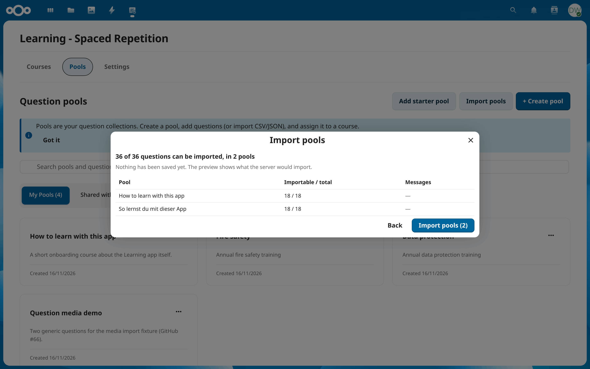

**Add them to the course:**
1. In the course, go to **Learning space → Pools** and click **+ Add Pool**.
2. Tick the pools and click **Add n pool(s)**.

Each pool in the course has a **Rules** button. In step 5 you can use it to set the exam size for that pool. The other switches in it do not affect the certificate. As the dialog says: "Only the "Required pools" selection under Administration → Course rules → Certification decides about the certificate."

---

## Step 5 — Set up certification and the exam

Go to **Administration → Course rules** and scroll to **Certification**.

1. Switch on **Enable certification** (with the profile **Mandatory training with certificate** it is already on).
2. **Minimum score (%)**: your pass mark, for example 75.
3. **Required pools**: tick every pool a person must pass. Each required pool needs its **own** passed exam at the pass mark. If you tick none, any passed exam in the course is enough.
4. **Validity period (0 = unlimited)**: `1` and **Years** for a yearly training. You can also choose months or days. Months and years follow the calendar: a certificate issued on 16 March is valid until 16 March of the next year, and 29 February becomes 28 February. (A value in days, such as 365, drifts by one day in a leap year.)
5. **Offer learners "Add to LinkedIn"**: leave it off for an internal training (the profile switches it off). It is saved as soon as you click it.
6. Optional: **Exam scope (default for all pools)**, see below.
7. Click **Save** in this section. Each section on this page has its own Save button.

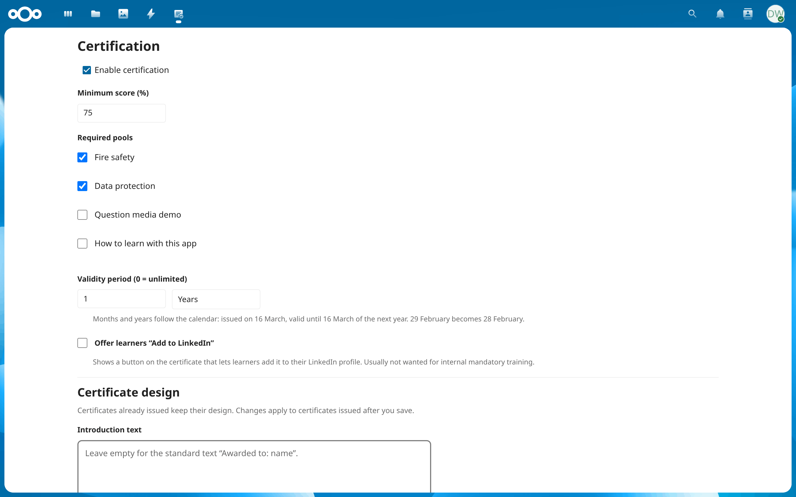

**How big the exam is.** Each exam is about **one pool**. You decide how many questions it has and how long it lasts, in two places:

- **For one pool:** in **Learning space → Pools**, click **Rules** on the pool. Under **Exam in this course**, set **Questions per exam** and **Time limit (minutes)**, then click **Save Rules**. The number of questions can't be higher than the number of questions in the pool.
- **For every pool of the course:** **Exam scope (default for all pools)** in the Certification section, with the same two fields. It applies to every pool that has no value of its own in its rules.

The questions are drawn at random from the pool on every attempt, so each attempt is different. If you set a number of questions but no time limit, the exam allows 90 seconds per question. If you leave everything empty, the exam follows the pool size: all of the pool's questions, up to 90 (with more than 90, a random selection on every attempt), 90 seconds per question, at most 2 hours. Learners get no feedback until the end.

**The certificate** shows: the organisation's logo and name, the course title, "Awarded to" with the person's name, **Course elements** (the required pools), Result, Minimum score, Issued on, Valid until, a QR code and the Certificate ID. If you tick no required pools, the certificate has no "Course elements".

**Certificate design** (below Certification, with its own **Save**) changes it for this course:
- **Issuing organisation → Logo:** Nextcloud's logo (Theming), or one of the certificate logos an administrator uploaded (step 1).
- **Organisation name on the certificate:** leave it empty to use the legal name from the operator details, or else the name of this Nextcloud. **Show organisation name** hides the name next to the logo, for a logo that already spells it out; the signed certificate and the verification page keep the name.
- **Elements on the certificate:** switches for logo, result, minimum score, course elements and validity date. The QR code and the verification link are always printed.
- An **Introduction text** with placeholders, and a **stamp and signature** as PNG files from your Nextcloud Files (at most 1 MB and 3000 × 3000 pixels), with the signer's name and position. A preview shows the result.

Certificates already issued keep their design; changes apply to certificates issued after you save.

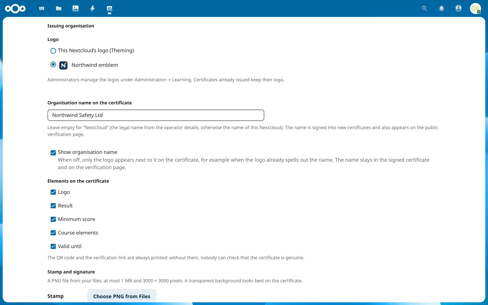

---

## Step 6 — Switch off what you don't need

If you created the course with the profile **Mandatory training with certificate** (step 2), these switches are already set as recommended below. Check them and go on.

Still under **Administration → Course rules**, in **Course rules — Learning modes**:

| Switch | Recommended | Why |
|---|---|---|
| **Training** | on | Practice with feedback after each answer. It does not count for the certificate. |
| **Leitner** | **off** | Spaced repetition. It is not needed here, and it is on in a new course. With it off, the server refuses Leitner to learners who have the pool only through this course, and the pool leaves their Smart Queue and due reminders. |
| **Exam** | **on** | Without it, nobody can be certified. |
| **Class register** | off | A member directory with profiles and kudos. On in a new course. |
| **Learning partner** | off | Matches learners who can help each other with a topic. On in a new course. |
| **Completion tab** | either | With certification on, learners get the **Completion & certificate** tab anyway. The switch only adds their summary statistics to it. |

Click **Save** under the switches.

If you switch off **Exam** by mistake, the certification section warns you: "The "Exam" learning mode is switched off in this course. Certificates are only earned with exams started here in the course, so nobody can receive a certificate."

**Game modes** (Duel, Gameshow, League, Adventure) sit in a collapsed area below the switches. Its heading shows how many are active. It should say **0 active**.

Further down on the same page:
- **Course rules — tools:** untick **Show simulator tools in this course**, then click **Save tools**. The simulators are IT practice tools (subnetting, DNS and so on) and are on in a new course.
- **Exam date:** leave it empty. It only drives a countdown and does not open or close the exam. People take the exam whenever they are ready.
- **Practice exam:** optional. If you switch on **Offer a practice exam**, learners get a practice run that never counts.

---

## Step 7 — Enrol your people

Go to **Participants → Members**.

1. In **People or groups**, type part of a name or a group name, and pick from the suggestions. You can pick several.
2. Leave **Role** on **Learner**. **Instructor** is for people who run the course, and they never get a certificate in it.
3. Click **Add**. A summary shows who was added, who was already enrolled and who was not found.

Everyone added gets the notification "You were enrolled in the course …".

**Groups are a snapshot.** "Choosing a group enrols everyone who is in the group right now. People who join the group later are not added automatically." When someone new joins your organisation, add them here.

---

## Step 8 — What learners see (and how to test it)

A learner opens **Courses** and then your course. They see **Learning space**, **Completion & certificate** and **Communication**, plus **Participants** only if something is left in it (for example the Class register while it is on).

1. **Learning space → Learning materials:** the required documents come first, each with **Open document** and **Confirm I have read this**, and a counter "Completed: 0 of 2". While the exam is locked, a note says so. Optional files follow under **More learning material**, and the privacy notice of the training is folded to one line at the end.

   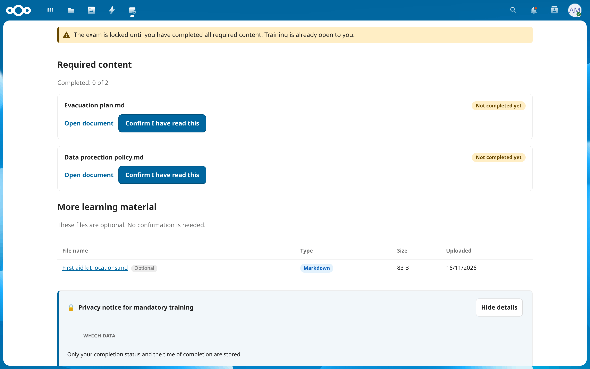

2. **Learning space → Training** (optional): practise with feedback.
3. **Learning space → Exam:** the tab shows the pass mark, and for each required pool the best result and whether it is passed. To take the exam, the learner clicks a pool and then **Start Exam**.
   Before starting, the exam screen must say: "This exam counts towards your certificate. Pass mark: 75%. No feedback until the end." The card above **Start Exam** shows the number of questions and the time limit.
   If that line is missing, the learner is in the wrong place. **Only exams started inside the course count.** An exam started from the top **Pools** menu does not count.

   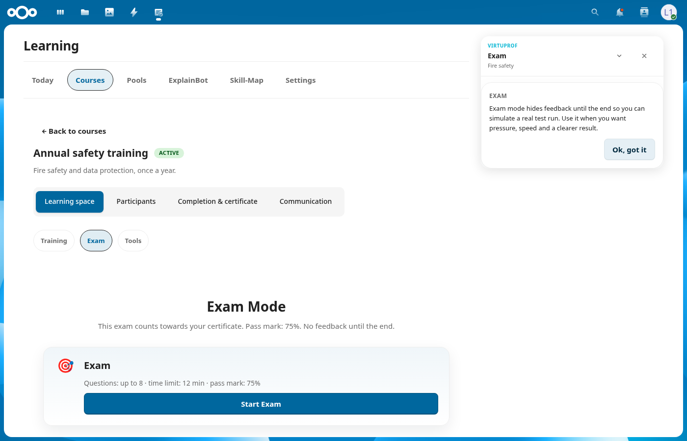

4. After the exam, the result screen says **Passed** or **Not passed**. If the last required pool was just passed, it shows **Certificate issued** and **Open certificate**. If pools are still missing, it says "Pool passed — still required: …". Learners also see the retake rules (attempts per pool in this course in 24 hours, minimum gap between two attempts).
5. **Completion & certificate:** shows Passed, the validity and when renewal opens, **View certificate**, and "What you need for the certificate" with every required pool and its best result. Click **View certificate**, then **Print**, to save it as a PDF (the print fills the page, A4 landscape by default).

   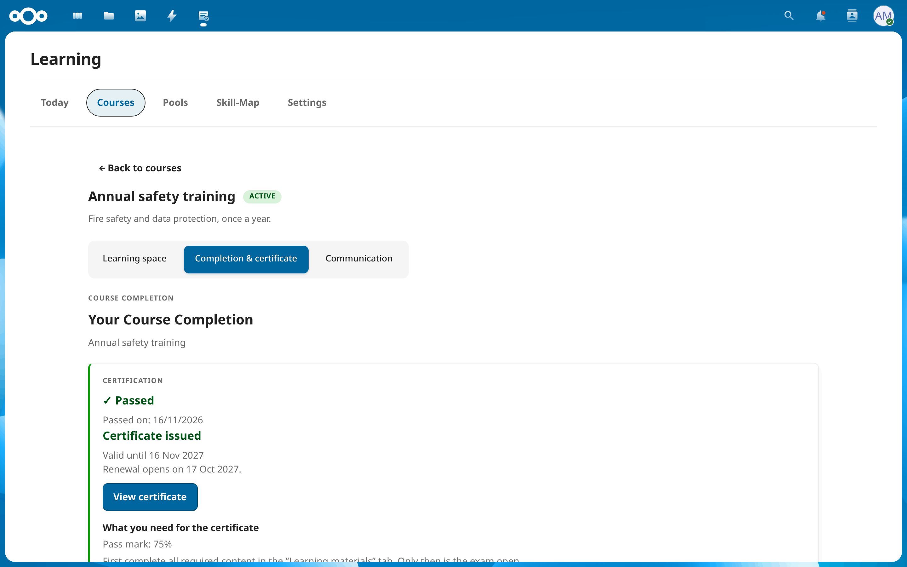


   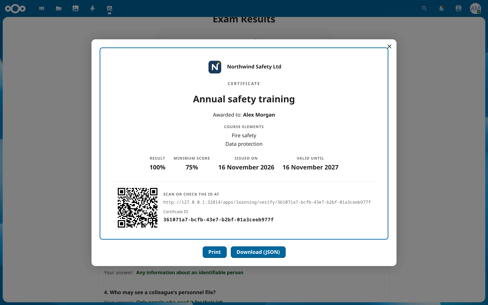

6. **Communication → Ask a question:** learners write to the course's instructors. Only they and the learner see the question and the answer. Instructors find it under **Communication → Questions from learners** and get a notification. The learner is notified when it is answered.

**Test it with a learner account, not your own.** Instructors never get a certificate in their own course. **Show student view** (under Settings → My Settings) only previews the layout and leaves no certificate behind.

---

## Step 9 — The yearly renewal

Once set up, the cycle runs by itself. It needs background jobs (step 1).

| When | What happens |
|---|---|
| 30 days before expiry | Renewal opens. The learner gets the notification "Your certificate "…" expires in 30 days", and the completion tab shows **Renewal open**. |
| 7 days before expiry | A second reminder. |
| Renewal exam passed | The learner must pass a new exam in **every** required pool inside the window. Then a new certificate is issued. If this happens before the expiry date, **its validity continues from the old expiry date**, so renewing early costs nothing. If it happens after the expiry date, the validity starts on the exam day. The old certificate stays valid until its own end date. |
| Expiry + 14 days, not renewed | The old period is closed and a new one opens. The next passed exam issues a fresh certificate, valid from that day. |

Only exams taken inside the renewal window count. Last year's exam can never renew a certificate. Before renewal opens, the completion tab says "Renewal opens on {date}".

With **Confirm required documents again at every renewal** on (step 3), the required documents are open again as soon as the renewal window opens: the learner sees "Not confirmed yet for the current certification period." and, with the exam lock on, confirms them again before the renewal exam.

Optional, for administrators (command line): `recert_reminder_thresholds` (default `30,7`; the largest value also sets when renewal opens) and `recert_grace_days` (default `14`). For example:
```
occ config:app:set learning recert_reminder_thresholds --value=60,14
```

---

## Step 10 — Audit evidence

Go to **Participants → Completion & certificate**. The **Compliance report** is there.

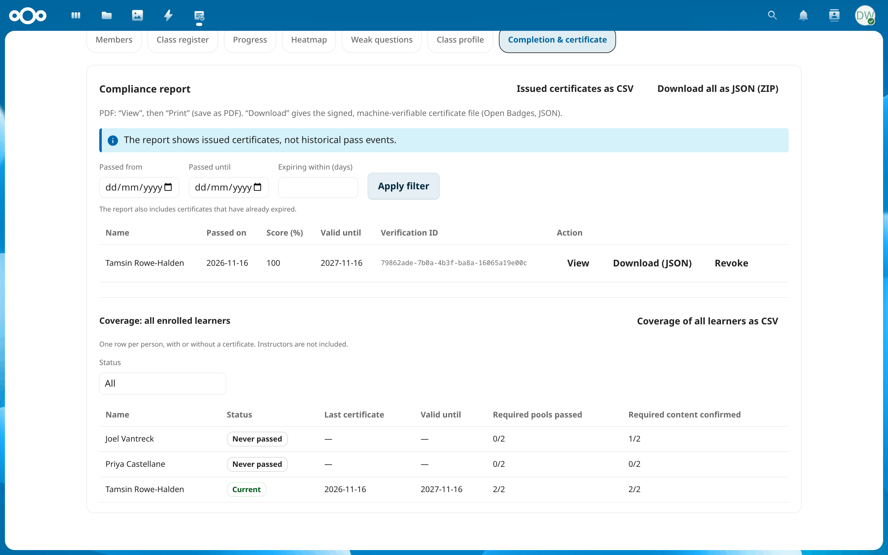

- **The table** lists every issued certificate: Name, Passed on, Score (%), Valid until (with "Expired" where it applies), Verification ID.
  "The report shows issued certificates, not historical pass events."
- **Filters:** **Passed from**, **Passed until**, **Expiring within (days)**, then **Apply filter**. For example, enter 60 in "Expiring within (days)" to see who must renew soon.
- **Export CSV:** the list the table shows, with the filter applied. Column names and statuses are in the language of the person exporting, and the file is UTF-8 (with a byte-order mark, so spreadsheet programs show umlauts and accents correctly).
- **Copies of the certificates:**
  - **View** opens a person's certificate. Use **Print** there to file it as a PDF.
  - **Download (JSON)** gives the signed, machine-verifiable certificate file (Open Badges).
  - **Download all as JSON (ZIP)** packs the certificates of the list currently shown.

  Every view and download is written to the audit log.
- **Revoke** withdraws a certificate, after a confirmation. **This cannot be undone.** After that, its verification page shows "Certificate withdrawn".
- If someone passed but has no certificate (for example, the signing key is missing), a warning names them.

**Coverage: all enrolled learners** is below the report. It lists everyone enrolled as a learner, also those who never passed, with their status (Current, Renewal open, Expired in grace period, Overdue, Never passed), the last certificate, valid until, the required pools passed and, if the course has required content, how many items they have confirmed for the current period. Filter by status; **Coverage of all learners as CSV** downloads the list shown.

**Checking a certificate.** Anyone can scan the QR code or open the verification link on the certificate. The public page shows the issuer, the address of the Nextcloud whose key signed the certificate ("Signed by"; the organisation name is set per course, the address is what the signature vouches for), the course, the course elements, the issue and expiry dates, and whether the certificate is valid, expired or withdrawn. For data protection, it does not show the holder's name. The verifier compares the Certificate ID on the document with the one on the page.

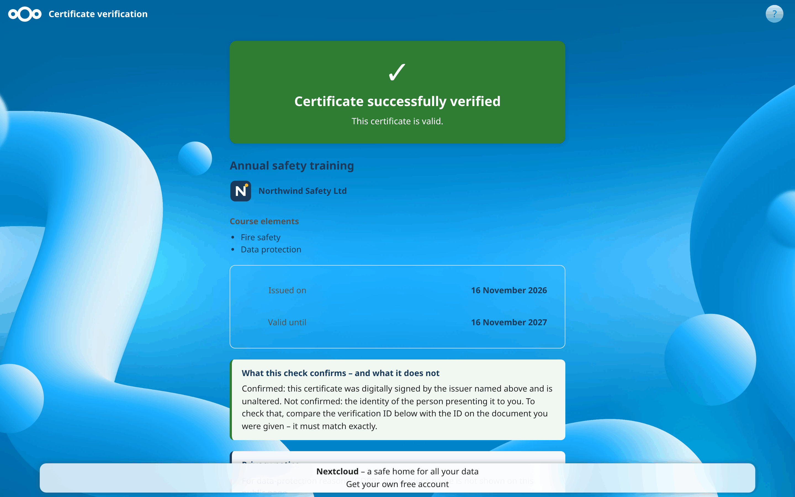

**For an external auditor.** The administrator creates a Nextcloud group named `learning-auditors`, which does not exist by default, and adds the auditor to it. To use another group, run `occ config:app:set learning auditor_group --value=<group id>`. Members of that group can open `/apps/learning/audit/export` on your Nextcloud. There they download a signed, tamper-evident event log (JSONL plus a .sig file) or open a printable report. The app has no menu link to this page, so send them the address.

**Team leads.** The app has a **Team Lead Dashboard**: missing or overdue members, upcoming expirations and a **Send reminder** button for one group. It appears on the Courses page for people assigned as team lead. Assigning a team lead in the app is **(coming)**. Until then, use **Export CSV** and send the file to the team leads. Don't add a team lead to the course as **Instructor** to work around this. An Instructor can change the whole course and never gets a certificate in it, so a team lead who has to do the training themselves could not be certified.

---

## Glossary

Terms you will meet in the app that this setup does not need, as of 5.14.0.

**Pool** — A set of questions. A pool belongs to the person who created it, not to a course, and can be added to several courses. Each course decides for itself what a pool counts for (Required pools, pool rules). Opened from the top **Pools** menu, a pool is a practice area of its own, and an exam there never counts for a certificate.

**Leitner** — Flashcard practice with five boxes. A correct answer moves a question up one box and it comes back later and later. A wrong answer sends it back to box 1. It does not affect the certificate, so you can switch it off per course (step 6).

**Smart Queue** — One list of all Leitner questions that are due for a learner, from all their pools, most urgent first. It belongs to Leitner: it stays empty for anyone who never started Leitner, and a pool leaves it for learners who reach that pool only through courses with Leitner switched off. It is not shown inside a course.

**Class register** — A member directory in the course's Participants area. Learners who press "Make visible in course" appear with their name, short bio and the topics they can help with, and members can give each other kudos. It has nothing to do with the certificate. Switch: **Class register** in Course rules.

**Learning profile** — An optional "about me" form each person fills in under their settings (role, goals, "I can help with..." / "I need help with...", Visibility: Private, Course or Public). Learning partner, the Class register and the AI chat (only if AI is on and the person agreed) use it. Nobody has to fill it in, and the training and the certificate don't depend on it.

**Learning partner** — Under Communication, learners see other members of the course who can help with a topic they need, or need help with a topic they know. It is based on the help topics in the learning profile. Switch: **Learning partner** in Course rules.

**Feed and Announcements** — **Announcements** (instructors only) is the form where you write a message to the course. Published announcements appear in the **Feed**, which every member sees, together with automatic entries such as "New question pool: …". Instructors edit or delete announcements in the Feed. An edited one is marked "edited".

**Questions from learners** — The instructors' inbox under Communication. Learners send questions with **Ask a question** (or through the VirtuProf help). Instructors answer with **Send answer**, and both sides get a notification. Only the learner and the course's instructors see a question.

**Arena, Duel, Gameshow, League, Adventure** — Optional games between course members. **Duel** is one against one, **Gameshow** a live quiz round for 2 to 5 players. Both appear in the **Arena** tab, which has no switch of its own. **League** is a season with a standings table. **Adventure** is a story mode (in German only) with questions built into the story. None of them counts for the certificate. With gamification off, League, Arena and Adventure are hidden for everyone, and new courses start with all of them off. They sit in the collapsed "Game modes" area of Course rules.

**VirtuProf** — The animated helper in the side panel. It offers ready-made help and tips without any AI. Its AI chat only works if an administrator has set up an AI provider and the learner has agreed to AI use. Each person can switch it off with **Virtual assistant** in their settings. Learners don't need it to ask the instructors a question (see Questions from learners).
